<picture>
  <source media="(prefers-color-scheme: dark)" srcset="assets/logo-dark.png">
  <source media="(prefers-color-scheme: light)" srcset="assets/logo-light.png">
  
</picture>

<picture>
  <source media="(prefers-color-scheme: dark)" srcset="assets/wordmark-dark.svg">
  <source media="(prefers-color-scheme: light)" srcset="assets/wordmark-light.svg">
  
</picture>

PlakhinLabs — это я: один человек, независимый разработчик и IT-специалист с многолетним практическим опытом. Я делаю приложения, которые хорошо решают одну задачу, экономят время и делают повседневную жизнь проще. Ни в одном из моих продуктов нет рекламы и слежки.

**Сайт:** https://plakhinlabs.github.io

## Проекты

**Расширения для Chrome**
- Undupe: закрывает дубликаты вкладок. [Chrome Web Store](ссылка)
- Amnezia: VPN для Chrome с вашим ключом. [Chrome Web Store](ссылка)

**Android-приложения**
- BiSonus: двойной плеер для музыки и фоновых звуков. [Google Play](https://play.google.com/store/apps/details?id=com.bisonus.app)

## Поддержать

Если проекты оказались полезны: https://plakhinlabs.github.io/support.html

## Контакты

plakhinlabs@gmail.com
